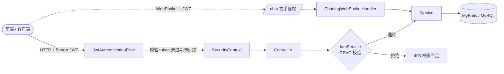
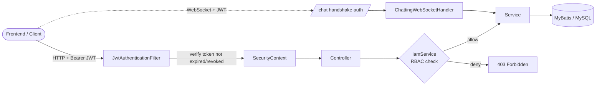

<div align="center">

# ⚓ One Piece Battles · Backend Service

**海贼王百科 & 对战模拟平台的后端 API 服务**
**Backend API for the One Piece encyclopedia & battle-simulation platform**

线上站点 / Live site：**[onepiece-battles.com](https://onepiece-battles.com)**

[]()
[]()
[]()
[]()
[]()
[]()
[]()

**[简体中文](#简体中文)** · **[English](#english)**

</div>

---

<a name="简体中文"></a>

## 简体中文

### 📖 项目简介

**One Piece Battles** 是一个以《海贼王》为主题的百科与对战模拟网站。用户可以**游客登录**或**注册账号**，创建自己的**角色**与**恶魔果实**，编排角色间或海贼团之间的**战斗**，添加**好友**、与好友**实时聊天**、创建/加入**群聊**，并对全站资源进行**搜索**。

本仓库是该网站的**后端服务**，基于 **Spring Boot 3 + Java 17** 构建，采用 **API-First（接口先行）** 的开发方式，使用 **JWT** 校验请求合法性，并通过 **RBAC（基于角色的访问控制）** 管理用户与资源之间的权限关系。

> 💡 前端与 OpenAPI 接口定义在独立仓库中维护，接口定义以 Git Submodule（`onepiece-battles-api`）形式引入本仓库。

### ✨ 核心功能

| 模块 | 功能 |
| --- | --- |
| 👤 **用户与登录** | 注册、登录、登出、游客（VISITOR）登录、修改资料、邮箱验证、找回密码 |
| 🔐 **权限与角色** | RBAC 权限体系、角色分配、资源级权限、资源共享（私有 / 公开 / 群组 / 系统） |
| 🧑‍🚀 **角色（Character）** | 内置 100 个默认角色，支持创建 / 修改 / 查询角色，设置攻击、防御、魔力、血量、智力、速度、团队增益等属性 |
| 🍎 **恶魔果实（Fruit）** | 内置 70 个默认果实，支持创建 / 查询，查看当前及历史拥有者，为角色「吃下」果实 |
| 🏴‍☠️ **海贼团（Group）** | 创建 / 编辑海贼团，支持角色入团、嵌套子团队、查询子团队与团员 |
| ⚔️ **战斗（Battle）** | 单挑与团战模拟，回合制战斗引擎（命中 / 闪避 / 见闻色霸气 / 能量血量消耗），异步执行并生成 PDF 战报邮件 |
| 🤝 **好友（Friendship）** | 添加 / 接受 / 拒绝好友请求、好友列表，通过后自动创建私聊会话 |
| 💬 **聊天（Chatting）** | 基于 WebSocket 的实时单聊 / 群聊，历史消息同步、消息撤回、心跳保活 |
| 🔔 **通知（Notification）** | 好友请求 / 战斗请求等事件通知 |
| 🔎 **全局搜索** | 角色 / 果实 / 战斗 / 海贼团 / 用户等资源支持按名称与多维属性过滤检索（支持中英文 i18n 检索） |
| 🖼️ **图片与文件** | 图片上传 / 压缩（阿里云 OSS 对象存储）、文件下载 |
| 📄 **数据导出** | 战斗结果 PDF 报告生成与邮件推送 |
| 🐛 **问题反馈（Issue）** | 用户反馈的创建、列表、批量更新 |
| 🌏 **国际化** | 全站文案与资源内容支持中文（zh-CN）/ 英文（en-US）双语 |
| 📊 **审计与监控** | 资源操作血缘（Action Lineage）审计、Micrometer + Prometheus 指标 |

### 🧱 技术栈

| 分类 | 技术选型 |
| --- | --- |
| 语言 / 框架 | Java 17、Spring Boot 3.1.1、Spring Web MVC |
| 安全 | Spring Security、JWT（jjwt 0.11.5）、无状态会话 |
| 持久层 | MyBatis（mybatis-spring-boot-starter）、MySQL 8 |
| 数据库迁移 | Flyway |
| 实时通信 | Spring WebSocket |
| 任务调度 | Quartz（战斗执行、邮件发送、PDF 生成异步任务） |
| 接口定义 | OpenAPI 3 + OpenAPI Generator 5.4.0（接口先行，自动生成 Controller 接口与模型） |
| 对象转换 | MapStruct |
| 对象存储 | 阿里云 OSS |
| 文件生成 | OpenPDF / iText 7（PDF）、Apache Commons CSV |
| 邮件 | Spring Mail（SMTP） |
| 监控 | Micrometer + Prometheus |
| 构建 / 部署 | Gradle、Docker（多架构 buildx，推送至阿里云 ACR） |
| 测试 | TestNG、Mockito、AssertJ-DB、H2 |

### 🏗️ 架构设计

#### API-First（接口先行）

接口契约以 OpenAPI 规范维护在 Git Submodule `onepiece-battles-api` 中。构建时 `api` 子模块通过 **OpenAPI Generator** 自动生成：

- **Controller 接口** → `com.yichi.onepiece.api.*Api`
- **数据模型 / DTO** → `com.yichi.onepiece.model.*`

主模块中的 `@Controller` 类实现这些接口，保证代码与接口文档始终一致。

#### 分层结构

每个业务模块按「controller → service → model」分层，`model` 内进一步细分 `dao`（MyBatis 映射）、`entity`（实体）、`view`（视图对象）、`converter`（MapStruct 转换器）：

```
com.yichi.onepiece
├── configuration/   # 安全、WebSocket、MyBatis、Flyway、Quartz、CORS 等配置
├── iam/             # RBAC：角色、资源、权限的定义与校验
├── user/            # 用户、好友、认证
├── character/       # 角色
├── fruit/           # 恶魔果实
├── battle/          # 战斗（core = 回合制战斗引擎）
├── group/           # 海贼团（支持嵌套）
├── chatting/        # 会话与消息（WebSocket）
├── notification/    # 通知
├── issue/           # 问题反馈
├── image/ file/     # 图片与文件（阿里云 OSS）
├── data_export/     # PDF 战报导出
├── email/           # 邮件（验证 / 找回密码）
├── quartz/          # 异步定时任务
├── lineage/         # 操作血缘审计
├── support/         # 管理工具（批量导入等）
└── utils/           # JWT、加密、i18n 等工具
```

#### 请求处理流程



### 🔐 安全与权限（JWT + RBAC）

#### JWT 鉴权

- 客户端在 `Authorization: Bearer <token>` 头中携带 JWT；WebSocket 握手时也支持通过 `token` 查询参数传递。
- `JwtAuthenticationFilter` 校验签名与用户名，并在 `token` 表中确认该 token **未过期且未被吊销**，通过后写入 `SecurityContext`。
- 会话为 **无状态（STATELESS）**；登出时吊销 token。
- **无需鉴权**的公开端点：登录、注册、`/chat` 握手、找回密码相关接口、`OPTIONS` 预检。
- 跨域来源通过环境变量 `ONEPIECE_ALLOWED_ORIGINS` 配置。

#### RBAC（基于角色的访问控制）

**角色（UserRole）** — 权限由高到低：

| 角色 | 说明 |
| --- | --- |
| `NIKA` | 超级管理员，拥有全部资源的全部权限 |
| `ADMIN` | 管理员（不含删除 / 角色分配 / ROLE 资源管理） |
| `NORMAL` | 普通注册用户 |
| `VISITOR` | 游客，权限等同普通用户 |

**资源类型（ResourceType）**：`USER`、`CHARACTER`、`FRUIT`、`BATTLE`、`GROUP`、`CHATTING`、`ISSUE`、`ROLE`

**权限（Permission）**：`CREATE`、`LIST`、`GET`、`UPDATE`、`DELETE`、`BATCH_UPDATE`、`ASSIGN_ROLE`

**资源可见范围（ResourceScope）**：`SYSTEM`（系统内置）、`PRIVATE`（私有）、`PUBLIC`（公开）、`GROUP`（群组内可见）——用户可通过共享接口调整资源可见范围。

启动时 `PrepareResourceAndPermissionData`（`CommandLineRunner`）会自动初始化角色、资源与权限的映射数据；业务层通过 `IamService.checkPermissionOfCurrentAccount(...)` 逐一校验「当前登录角色 + 资源 + 操作」的权限组合。

### 💬 实时聊天（WebSocket）

- 端点：`/chat`，握手阶段由 `AuthHandshakeInterceptor` 完成 JWT 鉴权并绑定 `userId`。
- 支持消息类型：`CREATE_CHAT`（建群/建会话）、`JOIN_CHAT`（加入）、`SEND_MESSAGE`（发送）、`RETRACT_MESSAGE`（撤回）等。
- 连接建立后自动同步用户的会话列表与最近消息；单聊在好友通过验证时自动创建。
- 单条消息上限约 9MB；支持 `ping` 心跳保活；单条异常消息不会导致整个连接断开。

### 🗄️ 数据模型（主要数据表）

`user`、`user_role`、`role`、`resource`、`role_resource`、`user_resource`、`token`、
`character`、`character_to_fruit`、`fruit`、`haki`、
`battle`、`battle_process_detail`、`battle_status_detail`、
`group`、`conversation`、`user_conversation`、`message`、`friendship`、
`notification`、`issue`、`file_object`、`email_verification`、`action_lineage`

> 完整 DDL 见 [`src/main/resources/db/schema.md`](src/main/resources/db/schema.md)，数据库变更通过 [`src/main/resources/db/migration`](src/main/resources/db/migration) 下的 Flyway 脚本管理，应用启动时自动迁移。

### 🚀 快速开始

#### 环境要求

- JDK 17
- MySQL 8（本地默认 `localhost:3306`，数据库名 `onepiece`）
- Gradle（推荐使用仓库自带 `./gradlew`）

#### 拉取代码（含子模块）

```bash
git clone --recurse-submodules <repo-url>
cd backend
# 若已克隆但未拉取子模块：
git submodule update --init --recursive
```

#### 配置环境变量

| 变量 | 说明 |
| --- | --- |
| `PASSWORD` | MySQL `root` 用户密码 |
| `MAIL_PASSWORD` | 发信邮箱的 SMTP 授权码 |
| `ONEPIECE_ALLOWED_ORIGINS` | 允许的跨域来源（逗号分隔，如 `http://localhost:8081`） |

此外，构建依赖一个私有 Maven 仓库中的共享库 `org.onepiece-battles:infra-support`，需在 `~/.gradle/gradle.properties` 中配置访问令牌：

```properties
gitLabPrivateToken=<your-gitlab-token>
```

#### 初始化数据库

```bash
mysql -uroot -p -e "CREATE DATABASE onepiece CHARACTER SET utf8mb4;"
```

应用启动时 Flyway 会自动执行迁移脚本建表。

#### 构建与运行

```bash
# 构建（跳过测试）
./gradlew build -x test

# 本地运行
./gradlew bootRun
```

服务默认监听 Spring Boot 端口 `8080`（可通过 `server.port` 调整）；前端本地开发服务器运行在 `8081`。

#### Docker 部署

```bash
# 见 deploy.sh：构建多架构镜像并推送至阿里云容器镜像服务
./deploy.sh
```

### 🧪 测试

```bash
./gradlew test
```

测试使用 **TestNG + Mockito + AssertJ-DB**，并以 **H2** 内存数据库替代 MySQL；`DatabaseSchemaTests` 会校验数据库 Schema 的一致性。

### 📚 API 概览

所有接口以 `/api/onepiece/<模块>/<动作>` 形式组织，主要分组：

`user`（含 `add_friend` / `accept_friend` / `list_friend` 等）、`email`、`character`、`fruit`、`battle`、`group`、`chatting`（含 `send_message` / `retract_message`）、`notification`、`issue`、`image`、`file`、`export`、`iam`、`support`。

完整接口契约见 Git Submodule [`onepiece-battles-api/api/openapi.yaml`](onepiece-battles-api/api/openapi.yaml)。

### 📂 目录结构

```
backend/
├── api/                      # OpenAPI 代码生成子模块（生成接口 & 模型）
├── onepiece-battles-api/     # Git Submodule：OpenAPI 接口定义
├── src/main/java/            # 主业务代码
├── src/main/resources/
│   ├── application.properties
│   ├── db/                   # schema + Flyway 迁移脚本
│   ├── fruit.csv             # 默认恶魔果实数据
│   └── user-facing-constants.yaml
├── src/test/                 # 测试代码
├── build.gradle              # 根构建脚本
├── Dockerfile
└── deploy.sh
```

<div align="right"><a href="#-one-piece-battles--backend-service">↑ 返回顶部 / Back to top</a></div>

---

<a name="english"></a>

## English

### 📖 Overview

**One Piece Battles** is a *One Piece*-themed encyclopedia and battle-simulation website. Users can log in **as a guest** or **register an account**, create their own **characters** and **Devil Fruits**, stage **battles** between characters or pirate crews, add **friends**, **chat in real time**, create/join **group chats**, and **search** across all resources.

This repository is the site's **backend service**, built with **Spring Boot 3 + Java 17** using an **API-first** workflow. It validates every request with **JWT** and manages the relationship between users and resources through **RBAC (Role-Based Access Control)**.

> 💡 The frontend and the OpenAPI contract live in separate repositories; the contract is pulled in here as a Git submodule (`onepiece-battles-api`).

### ✨ Features

| Module | Capabilities |
| --- | --- |
| 👤 **Users & Auth** | Register, log in, log out, guest (VISITOR) login, profile update, email verification, password recovery |
| 🔐 **Roles & Permissions** | RBAC permission system, role assignment, resource-level permissions, resource sharing (private / public / group / system) |
| 🧑‍🚀 **Characters** | 100 built-in default characters; create / update / query characters with attack, defense, magic, HP, intelligence, speed, group-buff attributes |
| 🍎 **Devil Fruits** | 70 built-in default fruits; create / query, view current and historical owners, let a character "eat" a fruit |
| 🏴‍☠️ **Pirate Crews (Groups)** | Create / edit crews, add characters, nested sub-groups, list child groups & members |
| ⚔️ **Battles** | 1v1 and team-battle simulation via a round-based engine (hit / miss / Observation Haki / energy & HP loss); runs asynchronously and emails a PDF battle report |
| 🤝 **Friendship** | Send / accept / reject friend requests, friend list; a private conversation is auto-created once accepted |
| 💬 **Chat** | Real-time 1:1 and group chat over WebSocket, message-history sync, message retraction, heartbeat keep-alive |
| 🔔 **Notifications** | Event notifications for friend requests, battle requests, etc. |
| 🔎 **Global Search** | Characters / fruits / battles / crews / users are searchable by name and multi-dimensional filters (with zh-CN / en-US i18n search) |
| 🖼️ **Images & Files** | Image upload / compression (Alibaba Cloud OSS object storage), file download |
| 📄 **Data Export** | Battle-result PDF report generation and email delivery |
| 🐛 **Issue Feedback** | Create, list and batch-update user-submitted issues |
| 🌏 **Internationalization** | UI text and resource content available in both Chinese (zh-CN) and English (en-US) |
| 📊 **Audit & Metrics** | Resource action-lineage auditing, Micrometer + Prometheus metrics |

### 🧱 Tech Stack

| Area | Technology |
| --- | --- |
| Language / Framework | Java 17, Spring Boot 3.1.1, Spring Web MVC |
| Security | Spring Security, JWT (jjwt 0.11.5), stateless sessions |
| Persistence | MyBatis (mybatis-spring-boot-starter), MySQL 8 |
| DB Migration | Flyway |
| Realtime | Spring WebSocket |
| Scheduling | Quartz (async battle execution, email, PDF generation) |
| API Contract | OpenAPI 3 + OpenAPI Generator 5.4.0 (interface-first; generates controller interfaces & models) |
| Object Mapping | MapStruct |
| Object Storage | Alibaba Cloud OSS |
| File Generation | OpenPDF / iText 7 (PDF), Apache Commons CSV |
| Email | Spring Mail (SMTP) |
| Monitoring | Micrometer + Prometheus |
| Build / Deploy | Gradle, Docker (multi-arch buildx, pushed to Alibaba Cloud ACR) |
| Testing | TestNG, Mockito, AssertJ-DB, H2 |

### 🏗️ Architecture

#### API-First

The API contract is maintained as an OpenAPI spec in the `onepiece-battles-api` Git submodule. At build time, the `api` sub-module runs **OpenAPI Generator** to produce:

- **Controller interfaces** → `com.yichi.onepiece.api.*Api`
- **Models / DTOs** → `com.yichi.onepiece.model.*`

`@Controller` classes in the main module implement these interfaces, keeping code and documentation always in sync.

#### Layered structure

Each feature module is layered as `controller → service → model`, where `model` further splits into `dao` (MyBatis mappers), `entity`, `view` (view objects) and `converter` (MapStruct):

```
com.yichi.onepiece
├── configuration/   # Security, WebSocket, MyBatis, Flyway, Quartz, CORS, ...
├── iam/             # RBAC: role / resource / permission definition & checks
├── user/            # Users, friendship, authentication
├── character/       # Characters
├── fruit/           # Devil Fruits
├── battle/          # Battles (core = round-based battle engine)
├── group/           # Pirate crews (supports nesting)
├── chatting/        # Conversations & messages (WebSocket)
├── notification/    # Notifications
├── issue/           # Issue feedback
├── image/ file/     # Images & files (Alibaba Cloud OSS)
├── data_export/     # PDF battle-report export
├── email/           # Email (verification / password recovery)
├── quartz/          # Async scheduled jobs
├── lineage/         # Action-lineage auditing
├── support/         # Admin utilities (batch import, ...)
└── utils/           # JWT, encryption, i18n helpers
```

#### Request flow



### 🔐 Security & Access Control (JWT + RBAC)

#### JWT authentication

- Clients send the JWT in the `Authorization: Bearer <token>` header; the WebSocket handshake also accepts it via a `token` query parameter.
- `JwtAuthenticationFilter` verifies the signature and username, confirms in the `token` table that the token is **not expired and not revoked**, then populates the `SecurityContext`.
- Sessions are **stateless**; tokens are revoked on logout.
- **Public** (no-auth) endpoints: login, register, `/chat` handshake, password-recovery endpoints, and `OPTIONS` pre-flight.
- Allowed CORS origins are configured via the `ONEPIECE_ALLOWED_ORIGINS` environment variable.

#### RBAC (Role-Based Access Control)

**Roles (UserRole)** — from highest to lowest privilege:

| Role | Description |
| --- | --- |
| `NIKA` | Super admin, holds every permission on every resource |
| `ADMIN` | Administrator (no delete / role-assignment / ROLE-resource management) |
| `NORMAL` | Regular registered user |
| `VISITOR` | Guest, same permissions as a normal user |

**Resource types (ResourceType):** `USER`, `CHARACTER`, `FRUIT`, `BATTLE`, `GROUP`, `CHATTING`, `ISSUE`, `ROLE`

**Permissions:** `CREATE`, `LIST`, `GET`, `UPDATE`, `DELETE`, `BATCH_UPDATE`, `ASSIGN_ROLE`

**Resource scope (ResourceScope):** `SYSTEM` (built-in), `PRIVATE`, `PUBLIC`, `GROUP` — users can adjust a resource's visibility through the share endpoint.

At startup, `PrepareResourceAndPermissionData` (a `CommandLineRunner`) seeds the role/resource/permission mappings. The service layer enforces access with `IamService.checkPermissionOfCurrentAccount(...)`, checking each combination of *current role + resource + action*.

### 💬 Real-time Chat (WebSocket)

- Endpoint: `/chat`; `AuthHandshakeInterceptor` performs JWT authentication during the handshake and binds the `userId`.
- Supported message types: `CREATE_CHAT`, `JOIN_CHAT`, `SEND_MESSAGE`, `RETRACT_MESSAGE`, and more.
- On connect, the user's conversation list and recent messages are synchronized automatically; a 1:1 conversation is created when a friend request is accepted.
- Single-message cap is ~9 MB; `ping` heartbeats are supported, and one malformed message never tears down the whole connection.

### 🗄️ Data Model (main tables)

`user`, `user_role`, `role`, `resource`, `role_resource`, `user_resource`, `token`,
`character`, `character_to_fruit`, `fruit`, `haki`,
`battle`, `battle_process_detail`, `battle_status_detail`,
`group`, `conversation`, `user_conversation`, `message`, `friendship`,
`notification`, `issue`, `file_object`, `email_verification`, `action_lineage`

> Full DDL is in [`src/main/resources/db/schema.md`](src/main/resources/db/schema.md). Schema changes are managed by Flyway scripts under [`src/main/resources/db/migration`](src/main/resources/db/migration) and applied automatically at startup.

### 🚀 Getting Started

#### Prerequisites

- JDK 17
- MySQL 8 (defaults to `localhost:3306`, database name `onepiece`)
- Gradle (the bundled `./gradlew` wrapper is recommended)

#### Clone (with submodules)

```bash
git clone --recurse-submodules <repo-url>
cd backend
# If already cloned without submodules:
git submodule update --init --recursive
```

#### Environment variables

| Variable | Description |
| --- | --- |
| `PASSWORD` | MySQL `root` password |
| `MAIL_PASSWORD` | SMTP auth code for the sender mailbox |
| `ONEPIECE_ALLOWED_ORIGINS` | Allowed CORS origins, comma-separated (e.g. `http://localhost:8081`) |

The build also depends on a shared library `org.onepiece-battles:infra-support` hosted in a private Maven registry. Configure the access token in `~/.gradle/gradle.properties`:

```properties
gitLabPrivateToken=<your-gitlab-token>
```

#### Initialize the database

```bash
mysql -uroot -p -e "CREATE DATABASE onepiece CHARACTER SET utf8mb4;"
```

Flyway runs the migration scripts to create tables on application startup.

#### Build & run

```bash
# Build (skip tests)
./gradlew build -x test

# Run locally
./gradlew bootRun
```

The service listens on Spring Boot's default port `8080` (configurable via `server.port`); the frontend dev server runs on `8081`.

#### Docker deployment

```bash
# See deploy.sh: builds a multi-arch image and pushes it to Alibaba Cloud Container Registry
./deploy.sh
```

### 🧪 Testing

```bash
./gradlew test
```

Tests use **TestNG + Mockito + AssertJ-DB** with an in-memory **H2** database instead of MySQL; `DatabaseSchemaTests` validates schema consistency.

### 📚 API Overview

All endpoints follow the pattern `/api/onepiece/<module>/<action>`. Main groups:

`user` (incl. `add_friend` / `accept_friend` / `list_friend`), `email`, `character`, `fruit`, `battle`, `group`, `chatting` (incl. `send_message` / `retract_message`), `notification`, `issue`, `image`, `file`, `export`, `iam`, `support`.

The full contract lives in the Git submodule [`onepiece-battles-api/api/openapi.yaml`](onepiece-battles-api/api/openapi.yaml).

### 📂 Project Layout

```
backend/
├── api/                      # OpenAPI codegen sub-module (generates interfaces & models)
├── onepiece-battles-api/     # Git submodule: OpenAPI contract
├── src/main/java/            # Main application code
├── src/main/resources/
│   ├── application.properties
│   ├── db/                   # schema + Flyway migrations
│   ├── fruit.csv             # default Devil Fruit data
│   └── user-facing-constants.yaml
├── src/test/                 # Test code
├── build.gradle              # Root build script
├── Dockerfile
└── deploy.sh
```

<div align="right"><a href="#-one-piece-battles--backend-service">↑ Back to top / 返回顶部</a></div>

---

<div align="center">

*本项目仅为《海贼王》主题的技术学习与演示用途，与东映动画 / 集英社无任何官方关联。*
*This project is a technical study/demo built around a One Piece theme and is not officially affiliated with Toei Animation or Shueisha.*

</div>
